# Unified Cheat Menu layout handoff

A mockup of the in-game cheat menu (`gui/ucm_main_menu.gui`, 880×680 window), one screenshot per tab.
Labels come from `localization/english`. The interactive canvas is at
https://claude.ai/artifact/QcTNQrC7A55GvqP1XgdMTt (private until shared).

## Structure

- **Header:** title, `Target:` line, second-character line.
- **Left:** 11 category tabs, driven by `GetVariableSystem 'ucm_tab'`. Quick Actions is the default.
- **Right:** the active tab's pane: section headings (`UCM_SEC_*`), then a two-column grid of buttons.

## Tabs

| # | Tab | Screenshot |
|---|-----|-----------|
| 1 | Quick Actions | 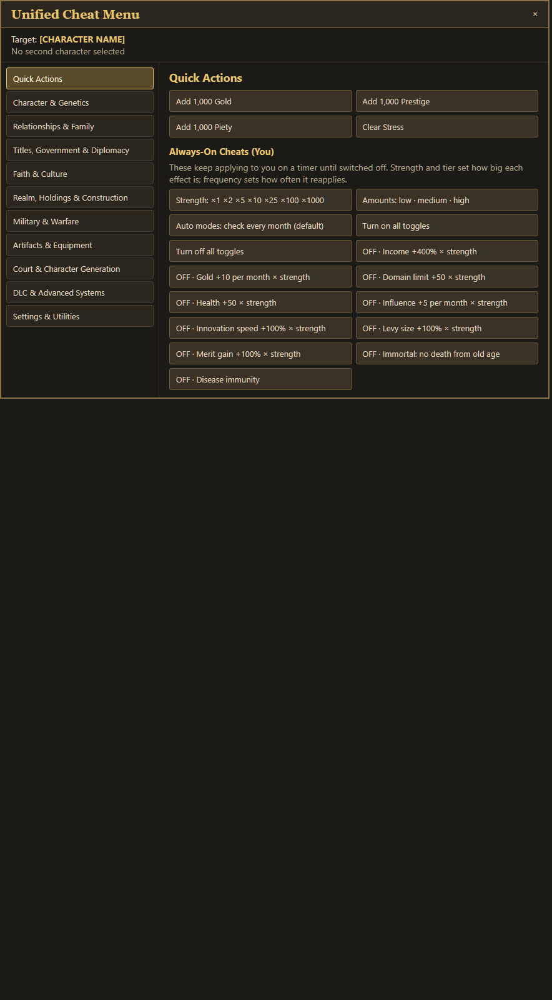 |
| 2 | Character & Genetics | 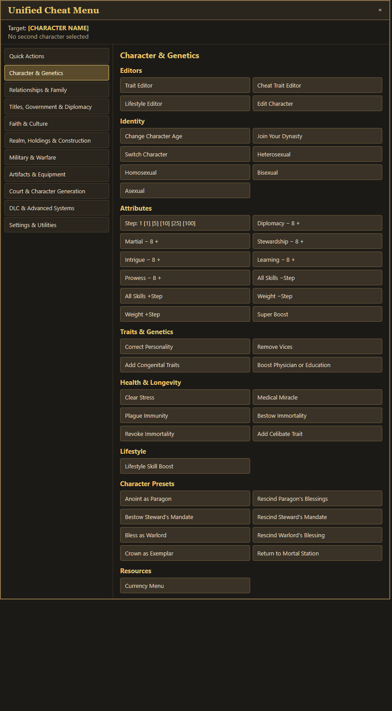 |
| 3 | Relationships & Family | 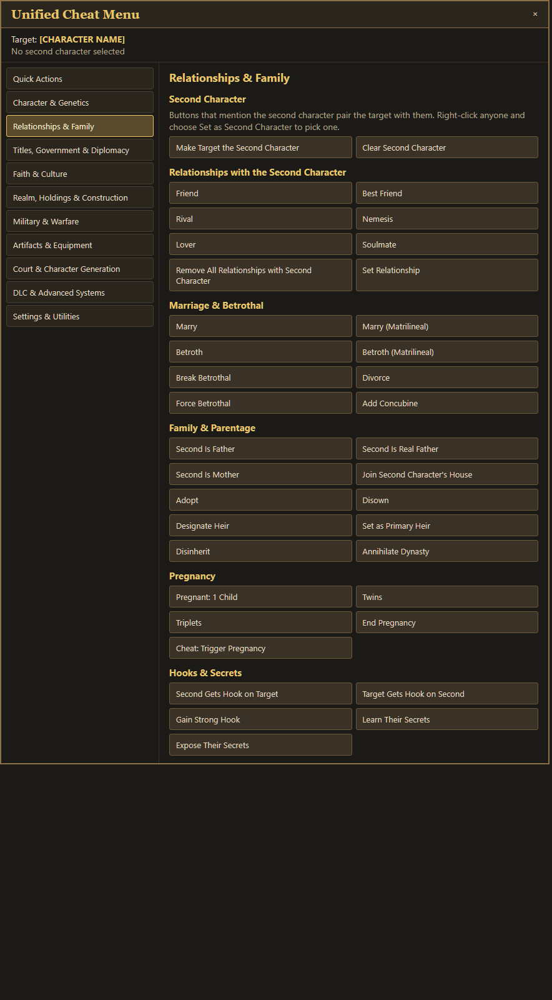 |
| 4 | Titles, Government & Diplomacy | 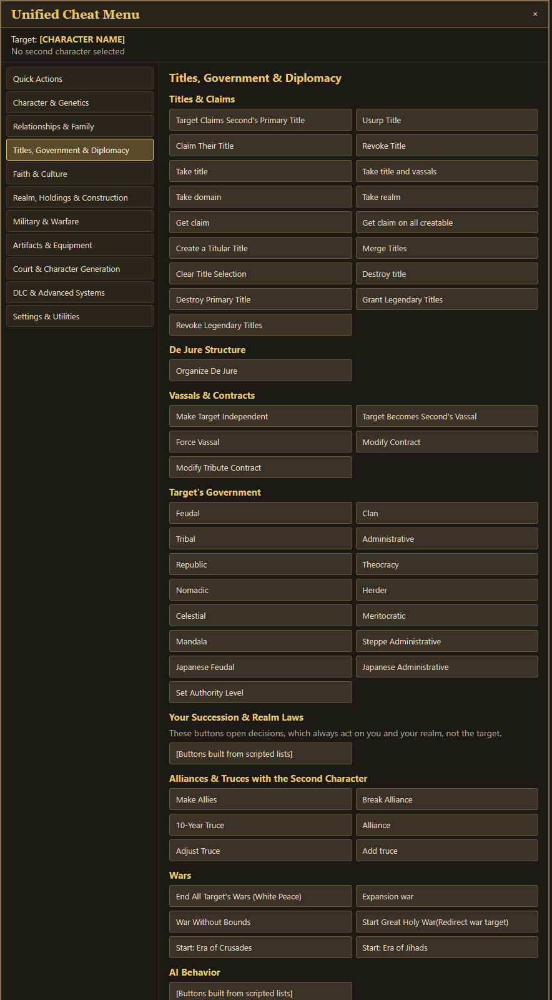 |
| 5 | Faith & Culture | 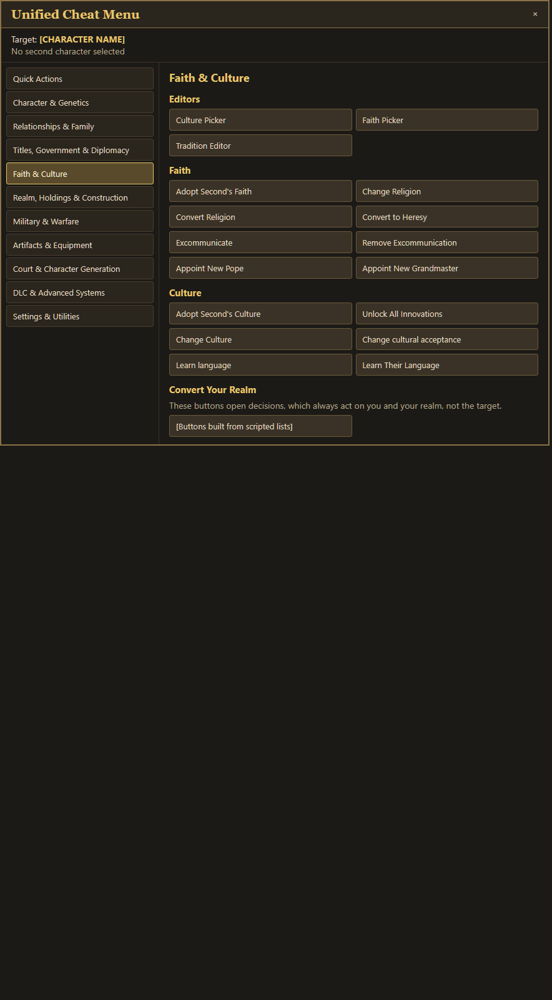 |
| 6 | Realm, Holdings & Construction | 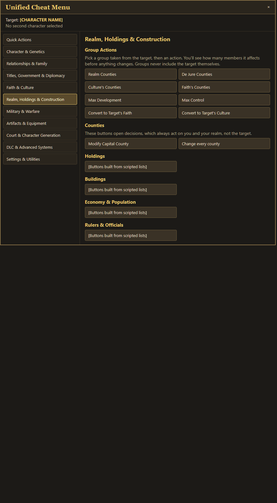 |
| 7 | Military & Warfare | 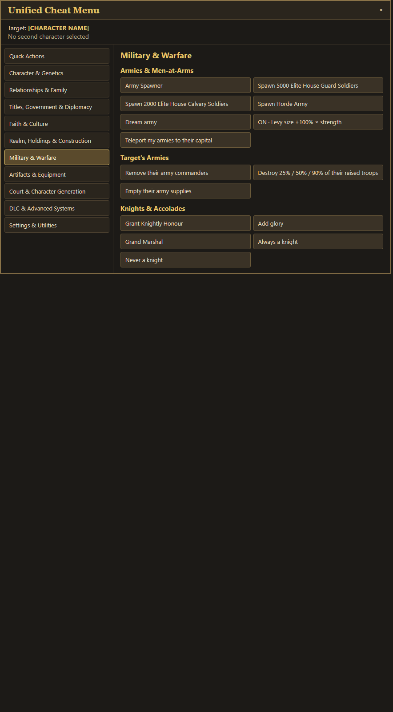 |
| 8 | Artifacts & Equipment | 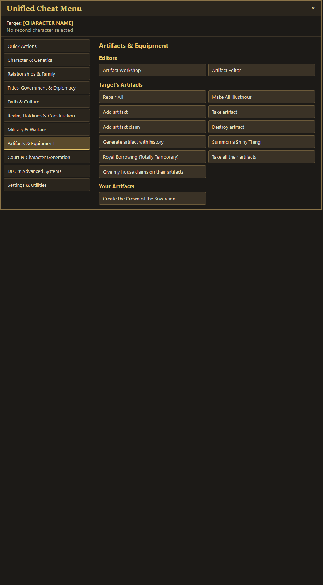 |
| 9 | Court & Character Generation | 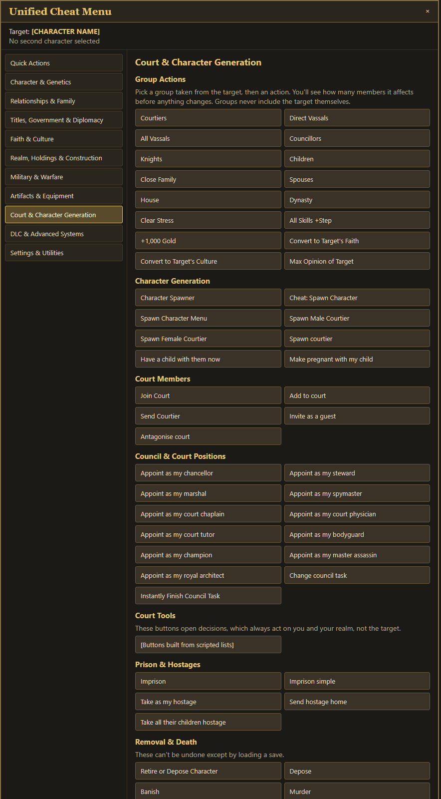 |
| 10 | DLC & Advanced Systems | 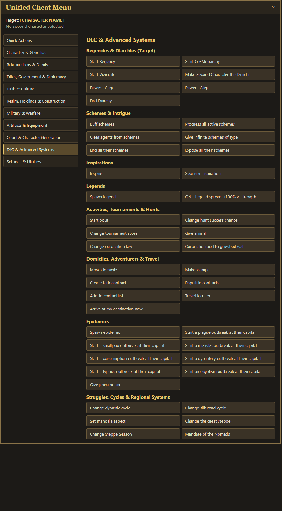 |
| 11 | Settings & Utilities | 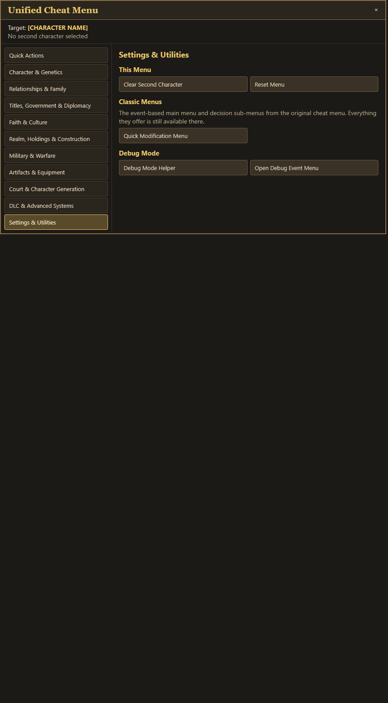 |

## Caveats

- Screenshots show each tab's full length. In game the pane scrolls inside the 680 px window.
- The colours are an approximation of CK3's dark-and-gold style, not the game's textures.
- `[Buttons built from scripted lists]` marks sections whose buttons are generated at runtime: Holdings, Buildings, Economy & Population, Rulers & Officials, AI Behavior, Succession & Realm Laws, Convert Your Realm and Court Tools.
- Some interactions have no English name. Their labels are made from the internal key, for example "Take title and vassals" from `take_title_interaction`. Those keys need real localization.
- The Quick Actions toggles are shown in the OFF state, and the Character skills use a placeholder value of 8.
